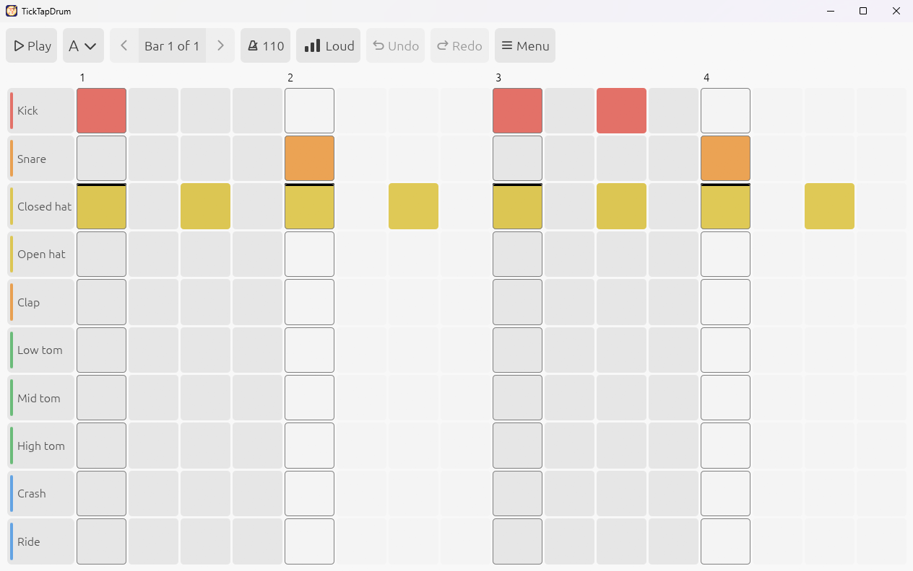

# TickTapDrum

TickTapDrum makes drum beats. You need no music knowledge: tap a box in the grid, and a drum plays
at that moment. It runs on Windows, macOS, Linux, Android, iPhone and iPad.

## What it does

- **A grid of steps.** Each row is a drum, such as kick, snare or hi-hat. Each box is a moment in
  time. Tap a box to turn it on or off, or drag to paint several.
- **Beats to start from.** Rock, Pop, Hip-hop, Funk, Bossa nova, House and Reggae, each with a
  fitting tempo and usually a fill. Also 359 beats and fills played by real drummers, in 24 styles.
- **Grooves from files and links.** Add drum grooves from MIDI files or zip packs, from a link,
  or shared from another app on Android. Paste a few bars of a drum tab.
- **Patterns and songs.** A pattern is a loop of one or more bars. A song plays patterns in order,
  such as A A B A.
- **Kits.** Choose a drum kit, such as Standard, Room, TR-808, TR-909, Jazz or Brush, from 63 kits.
- **Your own sound.** Set the tempo and swing. Each row has its own volume, mute and solo. Steps can
  be loud or soft.
- **Undo and redo** for every change. The app saves your project as you work, so nothing is lost
  if it closes.
- **Export** a MIDI file for other music software, or a WAV file to listen to anywhere.
- **MIDI out** on desktops and iOS: play the beat through a MIDI device or other music software.
- **Pictures for the drums**, for children who cannot read yet.
- **English and Brazilian Portuguese.** The app follows the system's language, or you can choose
  one in the ☰ menu.

## Install

Download the file for your system from the
[releases page](https://github.com/rrgmc/ticktapdrum/releases).

| System | File | How to install |
|---|---|---|
| Windows (x64) | `ticktapdrum-<version>-windows-x64-setup.exe` | Run it. It installs for your user only, so it needs no administrator rights. |
| Windows (x64) | `ticktapdrum-<version>-windows-x64.zip` | Unpack it and run `TickTapDrum.exe`. Nothing is installed. |
| macOS (Apple silicon) | `ticktapdrum-<version>-macos-arm64.dmg` | Open it and drag TickTapDrum to Applications. |
| Linux (x86_64) | `ticktapdrum_<version>_amd64.deb` | `sudo apt install ./ticktapdrum_<version>_amd64.deb` on Debian, or Ubuntu 22.04 and later. |
| Linux (x86_64) | `ticktapdrum-<version>-linux-x86_64.tar.gz` | Unpack it and run `ticktapdrum`. |
| Android | `ticktapdrum-<version>-android.apk` | Open it on the phone and allow installing apps from that source. |
| iPhone and iPad | `ticktapdrum-<version>-ios.ipa` | The file is not signed. A sideloading tool must sign it before iOS installs it. |

The first time you start it, your system may warn you about an unknown app:

- **Windows** says "Windows protected your PC". Choose **More info**, then **Run anyway**.
- **macOS** may refuse to open the app. Open it once, then go to **System Settings > Privacy &
  Security** and choose **Open Anyway**.

## The first start

TickTapDrum plays its drums from an instrument bank, ColomboGMGS2. The bank is a 227 MiB
download, so it is not inside the app. On the first start the app offers to download it, and keeps
it on your device. Its licence is CC-BY-SA 4.0. You can also load your own SoundFont (`.sf2`)
instead.

## Your projects

Save a project under a name from the ☰ menu. The app also saves the open project by itself a
second after each change, and reopens it the next time you start it. Projects are `.drums` files.
On a desktop, and on Android, you can also open and save them anywhere through the system's file
dialogs.

The app keeps the bank, your projects and the autosave in its data folder:

| System | Data folder |
|---|---|
| Windows | `%LOCALAPPDATA%\ticktapdrum` |
| macOS | `~/Library/Application Support/ticktapdrum` |
| Linux | `$XDG_DATA_HOME/ticktapdrum`, by default `~/.local/share/ticktapdrum` |
| Android and iOS | Inside the app. Uninstalling the app deletes it. |

On iPhone and iPad, exported files appear in the Files app, under **On My iPhone > TickTapDrum**.

## Author

Rangel Reale ([realerangel@gmail.com](mailto:realerangel@gmail.com))

## Licence

TickTapDrum is released under the [MIT licence](LICENSE). The instrument bank it downloads has
its own licence, CC-BY-SA 4.0.

The beats by real drummers come from the
[Groove MIDI Dataset](https://magenta.tensorflow.org/datasets/groove) by Google Magenta (Gillick,
Roberts, Engel, Eck and Bamman, 2019), licensed under
[CC BY 4.0](https://creativecommons.org/licenses/by/4.0/). The app keeps some of its beats, whole
takes of up to 16 bars, moved onto a 16-step grid; see
[`crates/dm-ui/assets/MAGENTA-CREDITS.txt`](crates/dm-ui/assets/MAGENTA-CREDITS.txt).

## Build it yourself

[`BUILDING.md`](BUILDING.md) explains how to build and run the app from source. The design and
its history are in [`docs/DESIGN.md`](docs/DESIGN.md).
